<!-- 顶部横幅 (动态波浪纹) -->

  

<!-- 动态打字特效，突出你的核心竞争力和身份 -->

  

 

<!-- 徽章区域 -->

  
  
  

## 🙋‍♂️ About Me

I am a Computer Science student at the University of Nottingham Ningbo China (UNNC), deeply passionate about **Artificial Intelligence**, **Robotics**, and **Algorithms**. I love bridging theoretical algorithms with real-world engineering challenges.

- 🎓 **Education**: UNNC CS (GPA: 3.68)
- 🔬 **Research**: Working on WAM and advanced robotic motion control.
- 📫 **Reach me at**: cyj070330@qq.com

---

## 🚀 Featured Projects & Research

I build things across AI, ROS 2 Robotics, and Multi-modal ML. Here are a few highlights:

- ⚙️ **[dji_full_wheel_chassis_controller](https://github.com/Yijin-Chen17/dji_full_wheel_chassis_controller)**: An advanced ROS 2 / C++ omnidirectional chassis controller for DJI motors with EtherCAT, Swerve IK, and cascade PID.
- 🔬 **[Industrial-anomaly-image-detection](https://github.com/Yijin-Chen17/Industrial-anomaly-image-detection)**: An unsupervised industrial anomaly detection framework for the Omni-AD benchmark, leveraging a frozen DINOv2 encoder and Transformer decoder for image-level scoring and pixel-level localization.
- 🦾 **[mujoco-manipulation-gym](https://github.com/Yijin-Chen17/mujoco-manipulation-gym)** *(In Development 🚧)*: An industrial-grade robotic manipulation and physics simulation framework built with MuJoCo, Pinocchio kinematics/dynamics, and modern C++/Python bindings.
- 🔍 **Lost Article Matching Platform (LAMP)**: A hackathon project leveraging CLIP for high-precision multi-modal (Text/Image) vector matching and retrieval.

---

## 🛠️ Tech Stack & Tools

  

---

## 📊 GitHub Stats

  
  

 

## 🐍 Contributions

  <picture>
    <source media="(prefers-color-scheme: dark)" srcset="https://raw.githubusercontent.com/Yijin-Chen17/Yijin-Chen17/output/github-contribution-grid-snake-dark.svg">
    <source media="(prefers-color-scheme: light)" srcset="https://raw.githubusercontent.com/Yijin-Chen17/Yijin-Chen17/output/github-contribution-grid-snake.svg">
    
  </picture>

